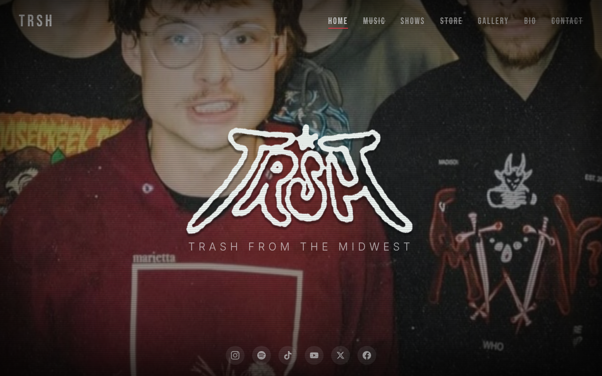
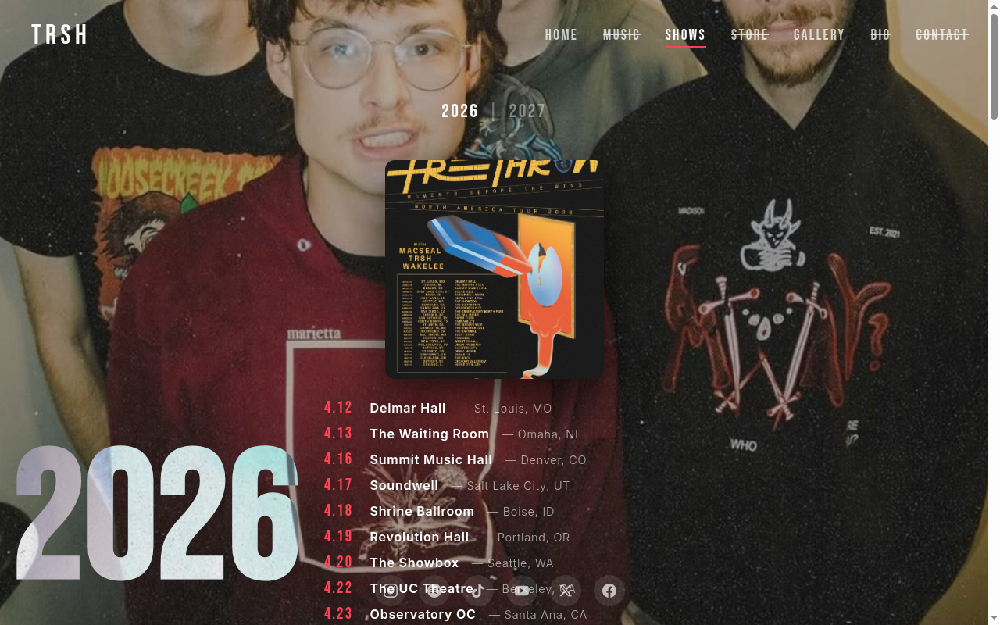
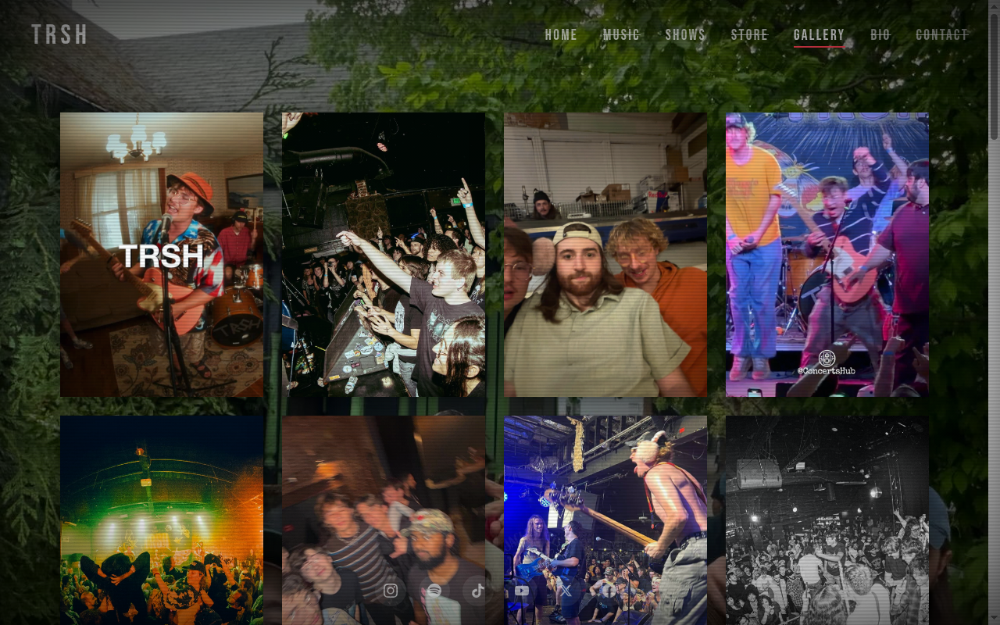
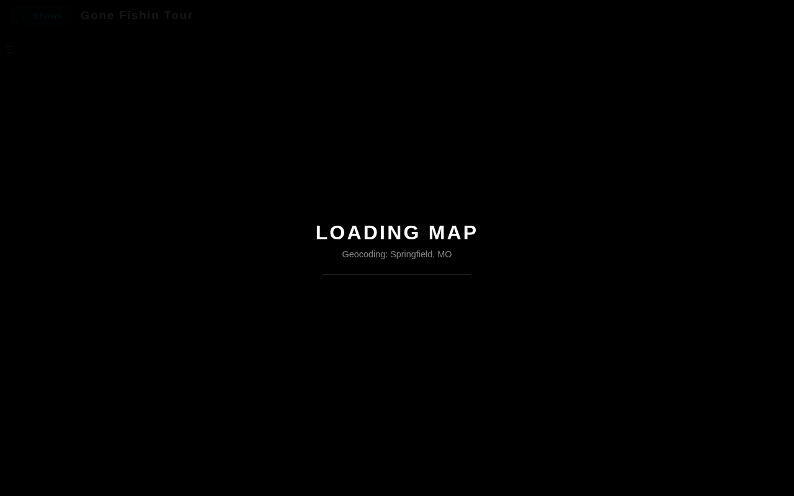

# TRSH Band Site

Static website for the band **TRSH**. Built with plain HTML, CSS, and vanilla JavaScript — no build step, no framework.

## Features

- **Shows / Tour Dates** — Full tour listings with dates, venues, and locations
- **Tour Map** — Click the **Eye icon** (👁) on any show entry to open an interactive Leaflet map showing mapped locations and driving routes for that tour. Stops are geocoded via Nominatim and routed through OSRM.
- **Photo Gallery** — Fullscreen viewer with pan/zoom/pinch support
- **Background Slideshow** — Ken Burns effect with transition animations

## Screenshots

### Home

### Shows

### Gallery

### Tour Map (via Eye icon)

## Structure

| File | Purpose |
|------|---------|
| `index.html` | Home page (logo, tagline, slideshow background) |
| `shows.html` | Shows/tour dates page |
| `gallery.html` | Photo gallery grid + fullscreen viewer |
| `map.html` | Leaflet tour map (loaded with `?tour=<id>`) |
| `map-data.js` | Tour data (single source of truth for map) |
| `script.js` | Shared: slideshow, mobile menu, noise overlays, pixel shift |
| `style.css` | All styling |
| `Flyers/` | Show/tour flyer images |
| `TRSH-Gallery/` | Gallery photos |
| `Logo/` | Brand/logo assets |
